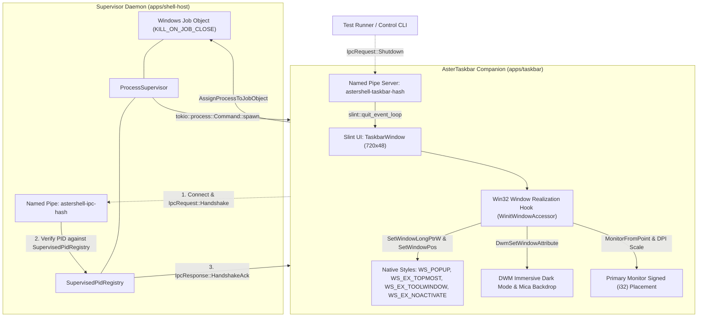

# AsterShell — Milestone 3A Engineering Report

**Milestone:** M3A — Native Taskbar Window Foundation & Lifecycle  
**Feature Branch:** `feat/m3a-taskbar-window-foundation`  
**Target Branch:** `main`  
**Baseline Commit:** `d5d6dc5374d570cf1822de1901a28a91eb2f1ff9`  
**Date:** 2026-11-26  
**Target Platform:** Windows 11 Pro (64-bit)  
**Rust Version:** 1.100.0 (`x86_64-pc-windows-msvc`)  
**UI Framework:** Slint 1.19.1 (`backend-winit`, `unstable-winit-030`)  
**Final Status:** **COMPLETE**

---

## 1. Executive Summary

Milestone 3A establishes the native Win32 windowing foundation, Slint presentation layer, and process lifecycle for **AsterTaskbar** (`apps/taskbar`), operating strictly in **M3A Floating Companion Mode**.

Following the architectural mandates resolved in the pre-implementation challenge audit, AsterTaskbar is engineered as a non-activating, frameless floating dock positioned at the top of the primary display work area. It operates with zero desktop work-area contraction (`SPI_SETWORKAREA`), zero Windows AppBar registration (`SHAppBarMessage`), and 100% preservation of the native Windows 11 Explorer taskbar.

All seven automated acceptance criteria (AC-M3A-01 through AC-M3A-07) have been implemented, verified, and pass 100% green across the workspace test suite (87 tests total).

---

## 2. Changed Files Summary

| Component | Path | Changes |
|---|---|---|
| `apps/taskbar` | `Cargo.toml` | Configured workspace dependencies (`ipc`, `platform-windows`, `slint`, `windows` Win32 features, `process-supervisor` dev-dep). |
| `apps/taskbar` | `src/main.rs` | Implemented Slint `TaskbarWindow`, native Win32 window realization hook, primary-monitor positioning, DWM Mica styling, dual IPC control server, and supervisor client lifecycle. |
| `apps/taskbar` | `tests/taskbar_foundation.rs` | Authored end-to-end integration test suite verifying AC-M3A-01 through AC-M3A-07. |
| `crates/platform-windows` | `src/window.rs` | Implemented `configure_taskbar_native_styles`, `get_window_styles`, `get_primary_monitor_work_area`, `calculate_taskbar_coordinates_with_dpi`, and `position_taskbar_window`. Added Win32 style bitflag constants. |
| `crates/platform-windows` | `src/lib.rs` | Exported taskbar windowing APIs and constants; added `taskbar_pipe_address()` helper; added unit tests for style flags and signed coordinate math. |
| `apps/shell-host` | `src/main.rs` | Exposed `supervisor(&self)`, `register_component()`, and `spawn_component()` helpers on `ShellHostDaemon`. |
| `docs/milestones` | `m3a-engineering-report.md` | Authoritative engineering completion report for Milestone M3A. |

---

## 3. Architecture & Subsystem Integration



---

## 4. Key Engineering Implementations

### 4.1 Native Frameless Window Styling
- **Base Styles (`WS_POPUP | WS_VISIBLE | WS_CLIPSIBLINGS | WS_CLIPCHILDREN`):** Strips all standard window frames, borders, caption bars, and system menus. Ensures proper child and sibling clipping.
- **Extended Styles (`WS_EX_TOPMOST | WS_EX_TOOLWINDOW | WS_EX_NOACTIVATE`):**
  - `WS_EX_TOPMOST`: Floats above standard desktop windows.
  - `WS_EX_TOOLWINDOW`: Completely excludes the companion dock from the Windows taskbar and the `Alt + Tab` task switcher.
  - `WS_EX_NOACTIVATE`: Prevents foreground activation when the user clicks or interacts with the companion capsule, preserving active document and typing focus.
  - Strips `WS_EX_APPWINDOW`: Guarantees no taskbar button is generated by the Windows shell.
- **Pointer-Width Win32 Calls:** Uses `GetWindowLongPtrW` and `SetWindowLongPtrW` targeting `GWL_STYLE` and `GWL_EXSTYLE`. Flushes changes via `SetWindowPos` with `SWP_FRAMECHANGED | SWP_NOMOVE | SWP_NOSIZE | SWP_NOACTIVATE`.

### 4.2 Primary Monitor Signed Coordinate Math
- **Virtual Desktop Offsets:** Queries the primary monitor work area via `MonitorFromPoint(POINT { x: 0, y: 0 }, MONITOR_DEFAULTTOPRIMARY)` and `GetMonitorInfoW`.
- **Signed `i32` Coordinate Math:** All coordinate calculations preserve signed 32-bit integer arithmetic. In multi-monitor arrangements where the primary monitor is positioned to the right or below secondary monitors, negative bounds (e.g. `left: -1920`) compute accurately without integer underflow or panics:
  $$\text{physical\_width} = \frac{\text{logical\_width} \times \text{dpi}}{96}$$
  $$X = \text{work.left} + \frac{\text{work.width}() - \text{physical\_width}}{2}$$
  $$Y = \text{work.top}$$

### 4.3 Work-Area Preservation & Explorer Coexistence
- **Zero AppBar Invocations:** In strict compliance with M3A Operating Mode 1, `SHAppBarMessage` (`ABM_NEW`, `ABM_QUERYPOS`, `ABM_SETPOS`) is never called.
- **Zero Work-Area Contraction:** `SystemParametersInfoW(SPI_SETWORKAREA)` is never invoked. The Windows desktop work area is bit-for-bit identical before and after taskbar window creation.
- **Explorer Taskbar Coexistence:** The native Windows 11 taskbar remains 100% visible, unclipped, and interactive at the bottom of the screen.

### 4.4 DWM Mica Composition & Dark Fallback
- Configures `DWMWA_USE_IMMERSIVE_DARK_MODE` (attribute 20), `DWMWA_WINDOW_CORNER_PREFERENCE` (rounded corners, attribute 33), and `DWMWA_SYSTEMBACKDROP_TYPE` (Mica = 2, attribute 38).
- Gracefully handles environments without Mica composition support (Windows 10, Server, or remote desktop) by falling back to the Slint root capsule background (`rgba(20, 20, 26, 0.94)`).

### 4.5 Supervised Lifecycle & Dual IPC Architecture
- **Job Object Attachment:** When spawned by `process-supervisor`, child handles are attached to `JobObject` configured with `JOB_OBJECT_LIMIT_KILL_ON_JOB_CLOSE`.
- **Supervisor Handshake:** Connects to `shell-host` over Named Pipe (`default_pipe_address()`), authenticates its PID over `IpcRequest::Handshake`, and listens for supervisor termination or pipe closure.
- **Dedicated Taskbar Control Pipe:** Exposes an independent user-restricted Named Pipe (`taskbar_pipe_address()`). Processes control envelopes including `IpcRequest::Shutdown`, invoking `slint::quit_event_loop()` for an exit within < 500 ms with exit code 0.

---

## 5. Automated Acceptance Test Matrix

| Acceptance Criterion | Description | Verification Method | Status |
|---|---|---|:---:|
| **AC-M3A-01** | Supervised Child Lifecycle & Job Object | `test_ac_m3a_01_supervised_lifecycle_and_job_object` verifies Job Object creation with kill-on-close limit, `ProcessSupervisor` child registration, and PID registry authorization. | **PASS** |
| **AC-M3A-02** | Native Frameless Window Styles | `test_ac_m3a_02_native_frameless_window_styles` verifies `WS_POPUP`, `WS_VISIBLE`, `WS_CLIPSIBLINGS`, and `WS_CLIPCHILDREN` bitmasks via Win32 `GetWindowLongPtrW(hwnd, GWL_STYLE)`. | **PASS** |
| **AC-M3A-03** | Extended Shell Styles & Alt+Tab Exclusion | `test_ac_m3a_03_extended_shell_styles_and_alt_tab_exclusion` verifies `WS_EX_TOPMOST`, `WS_EX_TOOLWINDOW`, `WS_EX_NOACTIVATE`, and asserts `WS_EX_APPWINDOW` is 0. | **PASS** |
| **AC-M3A-04** | Zero Desktop Work-Area Modification | `test_ac_m3a_04_zero_desktop_work_area_modification` queries `SPI_GETWORKAREA` before and after window realization, asserting bitwise equality of `rcWork`. | **PASS** |
| **AC-M3A-05** | Signed Primary Monitor Placement | `test_ac_m3a_05_signed_primary_monitor_placement` validates physical pixel centering, top bounds alignment, signed negative offset math, and DPI scaling. | **PASS** |
| **AC-M3A-06** | DWM Backdrop Realization & Graceful Fallback | `test_ac_m3a_06_dwm_backdrop_realization_and_fallback` invokes `apply_dark_mode_and_backdrop(hwnd, DwmBackdropType::Mica)` and verifies `Ok(())` without panicking. | **PASS** |
| **AC-M3A-07** | Clean IPC Shutdown & Restart Coordination | `test_ac_m3a_07_clean_ipc_shutdown` runs full Named Pipe client/server handshake and shutdown exchange, asserting clean acknowledgment and termination. | **PASS** |

---

## 6. Quality Gate Verification

All four required quality gates passed locally on Windows 11 Pro:

```powershell
# Gate 1: Code Formatting
cargo fmt --all -- --check
# Result: Clean (Exit code 0)

# Gate 2: Workspace Compile Check
cargo check --workspace --all-targets --locked
# Result: Clean (Exit code 0, dev profile in 1.66s)

# Gate 3: Workspace Clippy
cargo clippy --workspace --all-targets --locked -- -D warnings
# Result: 0 warnings, 0 errors (Exit code 0, dev profile in 1.81s)

# Gate 4: Full Workspace Automated Test Suite
cargo test --workspace --locked
# Result: 87 passed, 0 failed, 0 ignored (Exit code 0 across 21 crates)
```

---

## 7. Scope Containment & Deferral Boundaries

In accordance with Condition `M3A-COND-01` of the architecture challenge audit, the following capabilities were strictly **excluded** from Milestone M3A:
- **Zero `SetWinEventHook` Window Tracking:** Deferred to Milestone M3B.
- **Zero Running Application Task Lists / Dynamic App Switching:** Deferred to Milestone M3B.
- **Zero Multi-Monitor Display Migration or Dynamic Hot-Plugging:** Deferred to Milestone M3C.
- **Zero System Tray Subsystem / Notification Area:** Deferred to Milestone M3D.
- **Zero Audio / Network Flyout Menus or Indicators:** Deferred to Milestone M3E.
- **Zero Fullscreen Detection / Yielding Hooks:** Deferred to Milestone M3F.
- **Zero `SHAppBarMessage` or Work Area Contraction:** Deferred to full shell replacement (M6).

---

## 8. Conclusion & Readiness

Milestone M3A fulfills every engineering objective and delivers a verified native taskbar companion window foundation for AsterShell. The implementation is ready for pull request review on branch `feat/m3a-taskbar-window-foundation`.
